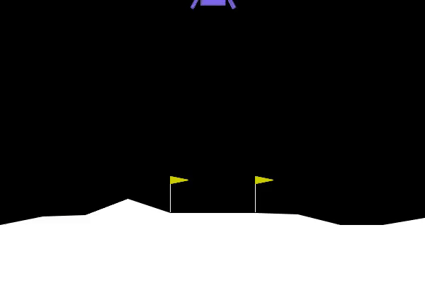

# LunarLander – Deep Q-Network (DQN)

A reinforcement learning project developed in Python using **PyTorch** and **Gymnasium** as part of an Artificial Intelligence university course.

The project implements a Deep Q-Network (DQN) agent trained to solve the LunarLander environment through trial and error, using neural networks to estimate action values.

## Demo



## Features

- **Deep Q-Network:** Custom DQN implementation using PyTorch.
- **Experience Replay:** NumPy-based circular buffer for storing and sampling training experiences.
- **Target Network:** Separate neural network periodically updated to stabilize training.
- **Epsilon-Greedy Exploration:** Balances exploration and exploitation during learning.
- **Model Evaluation:** Evaluate trained agents and compare their performance.
- **Experiment Tracking:** Save trained models, training plots, hyperparameters, and evaluation results.

## Implementation

The agent uses a fully connected neural network to approximate Q-values for the four available actions based on eight environment observations.

During training, experiences are stored in a replay buffer and randomly sampled in batches. The network learns using the Bellman equation, while a separate target network provides more stable training targets.

One of the main optimizations was replacing an inefficient list-based replay buffer with a **NumPy circular buffer**, avoiding costly `pop(0)` operations.

## Results

Multiple network architectures and hyperparameter configurations were evaluated.

One of the best-performing models, `64_relu_2nd`, achieved the following rewards during five evaluation episodes:

**264.22 | 266.79 | 285.84 | 248.66 | 282.70**

These results demonstrate successful agent training, although evaluation across more episodes would be needed to assess reliability.

More detailed experiments and observations are available in [Final Report](final_report.md).

## Technologies

- Python
- PyTorch
- NumPy
- Gymnasium (LunarLander)
- Matplotlib
- MoviePy

## Installation

**Requirements:** Python 3.13 and pip.

Clone the repository:

```bash
git clone https://github.com/Grodek17/RL_gymnasium_lander.git
cd RL_gymnasium_lander
```

Create a virtual environment:

```bash
python -m venv .venv
```

Activate it:

**Windows PowerShell:**

```powershell
.\.venv\Scripts\Activate.ps1
```

**Linux / macOS:**

```bash
source .venv/bin/activate
```

Install dependencies:

```bash
python -m pip install -r requirements.txt
```

## Usage

The current entry point is `main.py`.

```bash
python src/main.py
```

By default, the script evaluates the saved model `trained_networks/64_relu_2nd.pth`.

To train a new model, switch the function call in `main()` from `evaluation(...)` to `training()`.

Training parameters and neural network configuration can be adjusted in `constants.py`.


## Project Structure

```text
RL_gymnasium_lander/
├── src/
│   ├── main.py                  Training and main entry point
│   ├── eval.py                  Model evaluation and recording
│   ├── constants.py             Hyperparameters and configuration
│   ├── NeuralNetworkClass.py    Neural network architecture
│   ├── ExperienceBufferClass.py Experience replay buffer
│   ├── Network_save_class.py    Model metadata and saving
│   └── helpers.py               Utility functions
├── trained_networks/            Saved trained models (.pth)
├── plots/                       Training visualizations
├── videos/                      Recorded simulations and GIFs
├── final_report.md              Detailed project report
├── report_data.md               Experiment logs
├── requirements.txt             Python dependencies
├── .gitignore                   Ignored files and directories
└── README.md                    Project documentation
```


## Project Background

Developed during the Artificial Intelligence course at Gdańsk University of Technology.

The main learning objectives included neural network training, reinforcement learning, experience replay, optimization, and evaluating the stability of learned policies.

The repository preserves the original implementation and experimental results.

## Additional Evaluation

The saved `64_relu_2nd` model was successfully evaluated on 15 episodes in a fresh Python 3.13 environment.

- **14/15 episodes** achieved rewards above 200.
- Rewards ranged from **248.40 to 292.99** in those 14 episodes.
- One episode ended with a negative reward (-190.07).

These results demonstrate strong performance in this evaluation run, although larger-scale testing would be required to assess reliability.